# GGGCode Cases

> AUTO-GENERATED by `ts/cxx/buildDocs.script.ts` from `cases/*.yaml` — DO NOT EDIT.

Each case is one artifact wearing four hats: a behavioural **spec**, a piece of **documentation**, a runnable **example**, and a cross-engine conformance **test**. The contract is the decoded `values` stream within a global epsilon; `status` is the control response. Cases are grouped below by `tag` (a case appears under each tag it carries).

Programs run in the conformance harness. It preloads these fixtures: `r` dim `[3]` = `[10,20,30]`; `m` dim `[2,3]` = `[10,11,12,13,14,15]`; `bs` dim `[3,3]` = `[1,2,3,4,5,6,7,8,9]`; `bd` dim `[3,3]` = `[0,0,0,0,0,0,0,0,0]`. The tour expands fixture-dependent cases into standalone CLI programs.

See also: [tour](tour.md) · [commands](commands.md) · [glossary](glossary.md) · [runtime](runtime.md) · [protocol](protocol.md).

148 cases across 31 tags.

## Tags

- [async](#async) (6)
- [blit](#blit) (28)
- [conditionals](#conditionals) (6)
- [decimals](#decimals) (15)
- [failure](#failure) (3)
- [flip](#flip) (3)
- [flow](#flow) (23)
- [hex](#hex) (8)
- [irrational](#irrational) (3)
- [iteration](#iteration) (3)
- [lists](#lists) (11)
- [map](#map) (6)
- [matrix](#matrix) (18)
- [multiaxis](#multiaxis) (4)
- [normalized](#normalized) (2)
- [offset](#offset) (9)
- [operator](#operator) (10)
- [procedures](#procedures) (8)
- [protocol](#protocol) (4)
- [ranges](#ranges) (15)
- [reference](#reference) (2)
- [references](#references) (17)
- [region](#region) (1)
- [registers](#registers) (1)
- [rotate](#rotate) (3)
- [self-description](#self-description) (4)
- [signs](#signs) (1)
- [subscript](#subscript) (9)
- [trig](#trig) (4)
- [unicode](#unicode) (10)
- [unitary](#unitary) (14)

## async

### async_count

T12 G<n> runs an exported procedure n times, then unschedules it.

```
T10 L"tick"
P10 V7
T0
T12 R"tick" S0 G3
```

- values: `[7,7,7]`
- needs: `gggpx`, `gggtx`

### async_interval

T12 S<ms> fires only once the interval has elapsed on the host clock.

```
T10 L"tick"
P10 V7
T0
T12 R"tick" S500
```

- values: `[7,7]`
- needs: `gggpx`, `gggtx`

### async_unbounded

Omitting the run count exports indefinitely; the host decides when to stop.

```
T10 L"tick"
P10 V7
T0
T12 R"tick" S0
```

- values: `[7,7,7]`
- needs: `gggpx`, `gggtx`

### async_no_catchup

A late poll fires once, not once per missed interval.

```
T10 L"tick"
P10 V7
T0
T12 R"tick" S100
```

- values: `[7]`
- needs: `gggpx`, `gggtx`

### async_cancel

T12 G0 cancels an export; later polls fire nothing.

```
T10 L"tick"
P10 V7
T0
T12 R"tick" S0
T12 R"tick" G0
```

- values: `[]`
- status: (no response)
- needs: `gggpx`, `gggtx`

### async_unknown

Exporting an undefined procedure fails with F6.

```
T12 R"nope" S0
```

- values: `[]`
- status: `OZ`
- needs: `gggtx`

## blit

### blit_box_default

With no mode/coeffs the default box is the full source [0,dim] per axis -- an identity copy.

```
G40 R"bs" W"bd"
G10 R"bd"
```


- values: `[1,2,3,4,5,6,7,8,9]`
- needs: `ggggx`

### blit_box_full

An explicit full-source box M0,3,0,3 (min,max per axis, in source pixels) copies the source unchanged.

```
G40 R"bs" W"bd" T"box" M0,3,0,3
G10 R"bd"
```

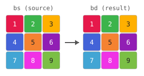

- values: `[1,2,3,4,5,6,7,8,9]`
- needs: `ggggx`

### blit_box_subregion

A box selects a source sub-rectangle (x columns 1..3) and stretches it to fill the dest; nearest filter (F1).

```
G40 R"bs" W"bd" T"box" M1,3,0,3 F1
G10 R"bd"
```

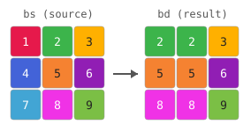

- values: `[2,2,3,5,5,6,8,8,9]`
- needs: `ggggx`

### blit_box_flip_x

A box flips an axis when its range runs backwards: M2.5,-0.5 on axis 0 (= [dim-0.5, -0.5], reversed + half-texel inset to land on pixel centers) mirrors each row left<->right. nearest filter (F1).

```
G40 R"bs" W"bd" T"box" M2.5,-0.5,0,3 F1
G10 R"bd"
```

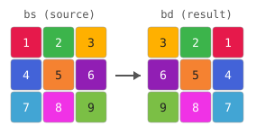

- values: `[3,2,1,6,5,4,9,8,7]`
- needs: `ggggx`

### blit_box_flip_y

Reversing the axis-1 range (M...,2.5,-0.5) flips the matrix top<->bottom, leaving axis 0 as-is. nearest filter (F1).

```
G40 R"bs" W"bd" T"box" M0,3,2.5,-0.5 F1
G10 R"bd"
```

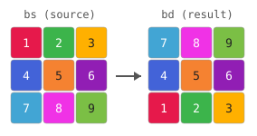

- values: `[7,8,9,4,5,6,1,2,3]`
- needs: `ggggx`

### blit_box_flip_180

Reversing both axes flips the matrix in both directions -- a 180-degree turn (every element reversed). nearest filter (F1).

```
G40 R"bs" W"bd" T"box" M2.5,-0.5,2.5,-0.5 F1
G10 R"bd"
```

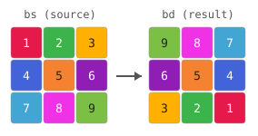

- values: `[9,8,7,6,5,4,3,2,1]`
- needs: `ggggx`

### blit_map_axes

map's triples are (srcAxis,min,max) positional by dest axis: M0,0,3,1,1,3 = dest0<-src0 full, dest1<-src1 rows 1..3 -- i.e. it generalizes box (same as box M0,3,1,3). nearest filter (F1).

```
G40 R"bs" W"bd" T"map" M0,0,3,1,1,3 F1
G10 R"bd"
```

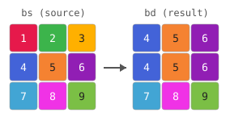

- values: `[4,5,6,4,5,6,7,8,9]`
- needs: `ggggx`

### blit_map_default

map with no triples leaves every dest axis identity (dest k <- src k, full source) -- an identity copy.

```
G40 R"bs" W"bd" T"map"
G10 R"bd"
```


- values: `[1,2,3,4,5,6,7,8,9]`
- needs: `ggggx`

### blit_map_transpose

Pointing each dest axis at the OTHER source axis (M1,0,3,0,0,3 = dest0<-src1, dest1<-src0) transposes the matrix (reflect across the main diagonal). nearest filter (F1).

```
G40 R"bs" W"bd" T"map" M1,0,3,0,0,3 F1
G10 R"bd"
```

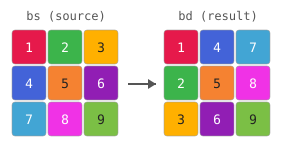

- values: `[1,4,7,2,5,8,3,6,9]`
- needs: `ggggx`

### blit_map_rotate_cw

A quarter turn clockwise = swap axes + reverse the swapped-in axis: M1,2.5,-0.5,0,0,3 (dest0<-src1 reversed, dest1<-src0). nearest filter (F1).

```
G40 R"bs" W"bd" T"map" M1,2.5,-0.5,0,0,3 F1
G10 R"bd"
```

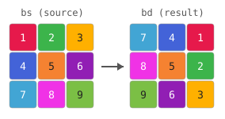

- values: `[7,4,1,8,5,2,9,6,3]`
- needs: `ggggx`

### blit_map_rotate_ccw

A quarter turn counter-clockwise = the other swap + reverse: M1,0,3,0,2.5,-0.5 (dest0<-src1, dest1<-src0 reversed). nearest filter (F1).

```
G40 R"bs" W"bd" T"map" M1,0,3,0,2.5,-0.5 F1
G10 R"bd"
```

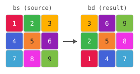

- values: `[3,6,9,2,5,8,1,4,7]`
- needs: `ggggx`

### blit_map_by_index

Mode by index T2 == map; a single triple (0,1,3) sets dest0<-src0 over [1,3] and leaves dest1 identity (== box [1,3] on axis 0). nearest filter (F1).

```
G40 R"bs" W"bd" T2 M0,1,3 F1
G10 R"bd"
```


- values: `[2,2,3,5,5,6,8,8,9]`
- needs: `ggggx`

### blit_affine_identity

Affine mode with the identity matrix (linear part + zero translation) copies the source.

```
G40 R"bs" W"bd" T"affine" M1,0,0,0,1,0
G10 R"bd"
```


- values: `[1,2,3,4,5,6,7,8,9]`
- needs: `ggggx`

### blit_mode_by_index

The transform mode accepts an index: T1 == affine.

```
G40 R"bs" W"bd" T1 M1,0,0,0,1,0
G10 R"bd"
```


- values: `[1,2,3,4,5,6,7,8,9]`
- needs: `ggggx`

### blit_offset

Offset mode uses direct pixel coordinates: M1,0 means dest[x,y] = source[x+1,y]. Zero edge exposes the vacated final column.

```
G40 R"bs" W"bd" T"offset" M1,0 F1 E3
G10 R"bd"
```

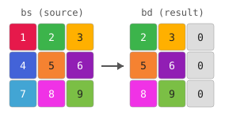

- values: `[2,3,0,5,6,0,8,9,0]`
- needs: `ggggx`

### blit_offset_by_index

The transform mode index T3 selects offset. M-1,0 samples the source pixel immediately to the left, with zero beyond the edge.

```
G40 R"bs" W"bd" T3 M-1,0 F1 E3
G10 R"bd"
```

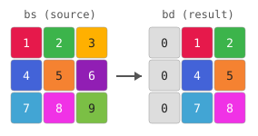

- values: `[0,1,2,0,4,5,0,7,8]`
- needs: `ggggx`

### blit_offset_fractional

Offset remains composable with filtering: M0.5,0 linearly interpolates halfway between horizontal source pixels; hold edge keeps the last column.

```
G40 R"bs" W"bd" T"offset" M0.5,0 E1
G10 R"bd"
```

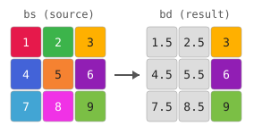

- values: `[1.5,2.5,3,4.5,5.5,6,7.5,8.5,9]`
- needs: `ggggx`

### blit_offset_region

P/S clips writes in absolute destination coordinates. At destination [1,1], offset M-1,-1 samples source [0,0].

```
G40 R"bs" W"bd" T"offset" M-1,-1 P1,1 S1,1 F1 E3
G10 R"bd"
```

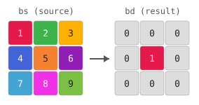

- values: `[0,0,0,0,1,0,0,0,0]`
- needs: `ggggx`

### blit_magnify_nearest

A half-extent box [0,1.5] per axis magnifies the top-left 2x2 of the source; nearest filter (F1).

```
G40 R"bs" W"bd" T"box" M0,1.5,0,1.5 F1
G10 R"bd"
```

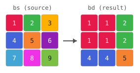

- values: `[1,1,2,1,1,2,4,4,5]`
- needs: `ggggx`

### blit_magnify_linear

Same half-extent box with the default linear filter interpolates between source texels (fractional result).

```
G40 R"bs" W"bd" T"box" M0,1.5,0,1.5
G10 R"bd"
```

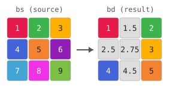

- values: `[1,1.5,2,2.5,2.75,3,4,4.5,5]`
- needs: `ggggx`

### blit_filter_per_axis

F is per-axis: F0,1 = linear on X (smooth, fractional), nearest on Y (blocky) -- a magnify interpolates columns but steps rows.

```
G40 R"bs" W"bd" T"box" M0,1.5,0,1.5 F0,1
G10 R"bd"
```

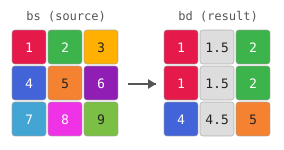

- values: `[1,1.5,2,1,1.5,2,4,4.5,5]`
- needs: `ggggx`

### blit_filter_by_name

Per-axis options also take names: F"linear","nearest" == F0,1 (a comma-separated quoted-string list, which parses identically in both engines).

```
G40 R"bs" W"bd" T"box" M0,1.5,0,1.5 F"linear","nearest"
G10 R"bd"
```


- values: `[1,1.5,2,1,1.5,2,4,4.5,5]`
- needs: `ggggx`

### blit_translate_hold

An axis-0 shifted box [1.2,4.2] with nearest filter + hold edge shifts and clamps at the edge (F1 E1).

```
G40 R"bs" W"bd" T"box" M1.2,4.2,0,3 F1 E1
G10 R"bd"
```

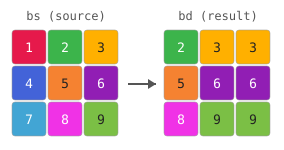

- values: `[2,3,3,5,6,6,8,9,9]`
- needs: `ggggx`

### blit_operator_add

Q combines the sampled value into the destination cell: a default (full-source) blit with add onto a dest pre-filled with 10.

```
G20 R"bd" V10,10,10,10,10,10,10,10,10
G40 R"bs" W"bd" Q"add"
G10 R"bd"
```

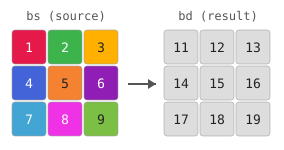

- values: `[11,12,13,14,15,16,17,18,19]`
- needs: `ggggx`

### blit_minify_lerp

Lerp WITH minify: a 1.5x oversized box [0,4.5] with the default linear filter (a point filter, no fold) ignores the footprint and just lerps the centre -- interpolated but aliased. linear coexists with minify; a fold (mean/min/max/add) is opt-in. Hold edge (E1).

```
G40 R"bs" W"bd" T"box" M0,4.5,0,4.5 E1
G10 R"bd"
```

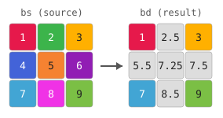

- values: `[1,2.5,3,5.5,7.25,7.5,7,8.5,9]`
- needs: `ggggx`

### blit_minify_mean

Explicit mean filter (F2): the 2x box [0,6] box-averages each cell's footprint (anti-aliases). mean is one filter value, not what linear does implicitly. Hold edge (E1).

```
G40 R"bs" W"bd" T"box" M0,6,0,6 F2 E1
G10 R"bd"
```


- values: `[1,2.75,3,5.5,7.25,7.5,7,8.75,9]`
- needs: `ggggx`

### blit_minify_max

F4 = max: the 2x minify pools the footprint maximum instead of averaging. Hold edge (E1).

```
G40 R"bs" W"bd" T"box" M0,6,0,6 F4 E1
G10 R"bd"
```

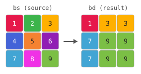

- values: `[1,3,3,7,9,9,7,9,9]`
- needs: `ggggx`

### blit_minify_pool

Separable per-axis filter: F4,2 = max-pool X (F4) but mean-pool Y (F2). Differs from a uniform fold, proving the filter is per-axis. Hold edge (E1).

```
G40 R"bs" W"bd" T"box" M0,6,0,6 F4,2 E1
G10 R"bd"
```

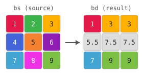

- values: `[1,3,3,5.5,7.5,7.5,7,9,9]`
- needs: `ggggx`

## conditionals

### cond_all_true

T9 A runs the block when all values are truthy.

```
T9 A1
P10 V42
T0
```

- values: `[42]`
- needs: `gggpx`, `gggtx`

### cond_all_false

T9 A skips the block when a value is falsy.

```
T9 A0
P10 V42
T0
```

- values: `[]`
- status: (no response)
- needs: `gggpx`, `gggtx`

### cond_all_mixed

T9 A requires every value truthy; a mix skips.

```
T9 A1,0
P10 V42
T0
```

- values: `[]`
- status: (no response)
- needs: `gggpx`, `gggtx`

### cond_any_true

T9 Y runs the block when any value is truthy.

```
T9 Y0,0,1
P10 V42
T0
```

- values: `[42]`
- needs: `gggpx`, `gggtx`

### cond_any_false

T9 Y skips the block when no value is truthy.

```
T9 Y0,0,0
P10 V42
T0
```

- values: `[]`
- status: (no response)
- needs: `gggpx`, `gggtx`

### cond_nested_skip

A skipped conditional skips its nested blocks too.

```
T9 A0
T9 A1
P10 V1
T0
T0
P10 V2
```

- values: `[2]`
- needs: `gggpx`, `gggtx`

## decimals

### print_single

A bare decimal value echoes back unchanged.

```
P10 V42
```

- values: `[42]`
- needs: `gggpx`

### print_request_id

A trailing O<id> arg tags the command; the id echoes on the return (here O7). With no O arg the id defaults to 1, rendering the familiar OK.

```
P10 V42 O7
```

- values: `[42]`
- needs: `gggpx`
- byte-exact (formatting is part of the contract)

### print_list

A comma-separated value list echoes each value in order.

```
P10 V1,2,3
```

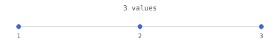

- values: `[1,2,3]`
- needs: `gggpx`

### print_zero

Zero is a value like any other.

```
P10 V0
```

- values: `[0]`
- needs: `gggpx`

### print_negatives

Negative decimals are preserved.

```
P10 V-5,-10,15
```

- values: `[-5,-10,15]`
- needs: `gggpx`

### print_bytes

Byte-range decimals echo unchanged.

```
P10 V255,128,64
```

- values: `[255,128,64]`
- needs: `gggpx`

### print_decimal

A negative fractional value is preserved.

```
P10 V-1.5
```

- values: `[-1.5]`
- needs: `gggpx`

### print_decimal_zero

A leading-zero fraction parses as a number, not a hex/zero prefix.

```
P10 V0.5
```

- values: `[0.5]`
- needs: `gggpx`

### number_trailing_exponent

A dangling exponent marker ends the number instead of discarding it.

```
P10 V5e
```

- values: `[5]`
- needs: `gggpx`

### number_trailing_letter

A trailing letter ends the number rather than discarding it.

```
P10 V5X
```

- values: `[5]`
- needs: `gggpx`

### number_ends_at_letter

A letter ends the number and begins a new argument.

```
P10 V5X10
```

- values: `[5]`
- needs: `gggpx`
- byte-exact (formatting is part of the contract)

### number_ends_at_sign

A sign begins another value under the same code.

```
P10 V5-3
```

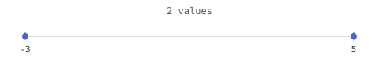

- values: `[5,-3]`
- needs: `gggpx`

### number_hex_prefix_not_absorbed

A mid-number hex prefix ends the number rather than forming a hex float.

```
P10 V-0x10
```


- values: `[0]`
- needs: `gggpx`
- byte-exact (formatting is part of the contract)

### number_leading_dot

A leading decimal point starts a number (.5 is 0.5).

```
P10 V.5,1
```

- values: `[0.5,1]`
- needs: `gggpx`

### number_second_dot

A second decimal point begins another value.

```
P10 V1.2.3
```

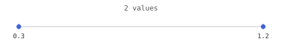

- values: `[1.2,0.3]`
- needs: `gggpx`

## failure

### matrix_write_missing

G20 reports BufferNotFound (F5) when R does not resolve.

```
G20 R"missing" V1
```

- values: `[]`
- status: `OZ`
- needs: `ggggx`
- byte-exact (formatting is part of the contract)

### matrix_read_alias_does_not_select

L never selects a buffer; G10 requires an R reference.

```
G10 L"r"
```

- values: `[]`
- status: `OZ`
- needs: `ggggx`

### matrix_write_alias_does_not_select

L never selects a buffer; G20 requires an R reference.

```
G20 L"r" V1
```

- values: `[]`
- status: `OZ`
- needs: `ggggx`
- byte-exact (formatting is part of the contract)

## flip

### blit_box_flip_x

A box flips an axis when its range runs backwards: M2.5,-0.5 on axis 0 (= [dim-0.5, -0.5], reversed + half-texel inset to land on pixel centers) mirrors each row left<->right. nearest filter (F1).

```
G40 R"bs" W"bd" T"box" M2.5,-0.5,0,3 F1
G10 R"bd"
```


- values: `[3,2,1,6,5,4,9,8,7]`
- needs: `ggggx`

### blit_box_flip_y

Reversing the axis-1 range (M...,2.5,-0.5) flips the matrix top<->bottom, leaving axis 0 as-is. nearest filter (F1).

```
G40 R"bs" W"bd" T"box" M0,3,2.5,-0.5 F1
G10 R"bd"
```


- values: `[7,8,9,4,5,6,1,2,3]`
- needs: `ggggx`

### blit_box_flip_180

Reversing both axes flips the matrix in both directions -- a 180-degree turn (every element reversed). nearest filter (F1).

```
G40 R"bs" W"bd" T"box" M2.5,-0.5,2.5,-0.5 F1
G10 R"bd"
```


- values: `[9,8,7,6,5,4,3,2,1]`
- needs: `ggggx`

## flow

### flow_define_only

Defining a procedure runs nothing and emits no response.

```
T10 L"p"
P10 V42
T0
```

- values: `[]`
- status: (no response)
- needs: `gggpx`, `gggtx`

### flow_define_run

T11 runs a previously defined procedure body.

```
T10 L"p"
P10 V42
T0
T11 R"p"
```

- values: `[42]`
- needs: `gggpx`, `gggtx`

### flow_unknown

Running an undefined procedure reports failure (an F<code> arg on the return).

```
T11 R"nope"
```

- values: `[]`
- status: `OZ`
- needs: `gggtx`

### flow_nested

Procedures may be defined and run nested.

```
T10 L"outer"
T10 L"inner"
P10 V7
T0
T0
T11 R"outer"
T11 R"inner"
```

- values: `[7]`
- needs: `gggpx`, `gggtx`

### cond_all_true

T9 A runs the block when all values are truthy.

```
T9 A1
P10 V42
T0
```

- values: `[42]`
- needs: `gggpx`, `gggtx`

### cond_all_false

T9 A skips the block when a value is falsy.

```
T9 A0
P10 V42
T0
```

- values: `[]`
- status: (no response)
- needs: `gggpx`, `gggtx`

### cond_all_mixed

T9 A requires every value truthy; a mix skips.

```
T9 A1,0
P10 V42
T0
```

- values: `[]`
- status: (no response)
- needs: `gggpx`, `gggtx`

### cond_any_true

T9 Y runs the block when any value is truthy.

```
T9 Y0,0,1
P10 V42
T0
```

- values: `[42]`
- needs: `gggpx`, `gggtx`

### cond_any_false

T9 Y skips the block when no value is truthy.

```
T9 Y0,0,0
P10 V42
T0
```

- values: `[]`
- status: (no response)
- needs: `gggpx`, `gggtx`

### cond_nested_skip

A skipped conditional skips its nested blocks too.

```
T9 A0
T9 A1
P10 V1
T0
T0
P10 V2
```

- values: `[2]`
- needs: `gggpx`, `gggtx`

### iter_single

T9 V runs the body once per value, exposing it as $it.

```
T9 V5 R"it"
P10 V$it
T0
```

- values: `[5]`
- needs: `gggpx`, `gggtx`

### iter_zero

Iterating an empty value set runs the body zero times.

```
T9 V$x R"it"
P10 V$it
T0
```

- values: `[]`
- status: (no response)
- needs: `gggpx`, `gggtx`

### iter_offset

T9 P writes each iteration value at a scalar offset in the selected register.

```
T9 V7,8 R"r" P1
P10 V$r[0:2]
T0
```

- values: `[10,7,30,10,8,30]`
- needs: `gggpx`, `gggtx`

### async_count

T12 G<n> runs an exported procedure n times, then unschedules it.

```
T10 L"tick"
P10 V7
T0
T12 R"tick" S0 G3
```

- values: `[7,7,7]`
- needs: `gggpx`, `gggtx`

### async_interval

T12 S<ms> fires only once the interval has elapsed on the host clock.

```
T10 L"tick"
P10 V7
T0
T12 R"tick" S500
```

- values: `[7,7]`
- needs: `gggpx`, `gggtx`

### async_unbounded

Omitting the run count exports indefinitely; the host decides when to stop.

```
T10 L"tick"
P10 V7
T0
T12 R"tick" S0
```

- values: `[7,7,7]`
- needs: `gggpx`, `gggtx`

### async_no_catchup

A late poll fires once, not once per missed interval.

```
T10 L"tick"
P10 V7
T0
T12 R"tick" S100
```

- values: `[7]`
- needs: `gggpx`, `gggtx`

### async_cancel

T12 G0 cancels an export; later polls fire nothing.

```
T10 L"tick"
P10 V7
T0
T12 R"tick" S0
T12 R"tick" G0
```

- values: `[]`
- status: (no response)
- needs: `gggpx`, `gggtx`

### async_unknown

Exporting an undefined procedure fails with F6.

```
T12 R"nope" S0
```

- values: `[]`
- status: `OZ`
- needs: `gggtx`

### proc_by_index

R addresses a procedure by index.

```
T10 L"p"
P10 V1
T0
T11 R0
```

- values: `[1]`
- needs: `gggpx`, `gggtx`

### proc_rename

T10 R<ref> L<name> renames a procedure.

```
T10 L"old"
P10 V1
T0
T10 R"old" L"new"
P10 V2
T0
T11 R"new"
```

- values: `[2]`
- needs: `gggpx`, `gggtx`

### proc_rename_old_gone

After a rename the old name no longer addresses the procedure.

```
T10 L"old"
P10 V1
T0
T10 R"old" L"new"
P10 V2
T0
T11 R"old"
```

- values: `[]`
- status: `OZ`
- needs: `gggpx`, `gggtx`

### proc_alias_does_not_select

L does not address a procedure; only R does.

```
T10 L"p"
P10 V1
T0
T11 L"p"
```

- values: `[]`
- status: `OZ`
- needs: `gggpx`, `gggtx`

## hex

### hex_1f

0X is a hexadecimal integer.

```
P10 V0X1F
```

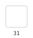

- values: `[31]`
- needs: `gggpx`

### hex_ff

0XFF is 255.

```
P10 V0XFF
```


- values: `[255]`
- needs: `gggpx`

### hex_zero

0X0 is zero.

```
P10 V0X0
```


- values: `[0]`
- needs: `gggpx`

### hex_100

Multi-digit hex integers carry across nibbles.

```
P10 V0X100
```

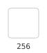

- values: `[256]`
- needs: `gggpx`

### hexlist_ff00

0I reads one value per hex nibble.

```
P10 V0IFF00
```

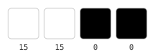

- values: `[15,15,0,0]`
- needs: `gggpx`

### hexnorm2_80

0H normalizes a two-nibble hex value to 0..1.

```
P10 V0H80
```


- values: `[0.5019607843137255]`
- needs: `gggpx`

### hexnorm1_8

0J normalizes a one-nibble hex value to 0..1.

```
P10 V0J8
```

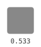

- values: `[0.5333333333333333]`
- needs: `gggpx`

### number_hex_prefix_not_absorbed

A mid-number hex prefix ends the number rather than forming a hex float.

```
P10 V-0x10
```


- values: `[0]`
- needs: `gggpx`
- byte-exact (formatting is part of the contract)

## irrational

### unitary_pi

π decodes to the mathematical constant.

```
P10 Vπ
```

- values: `[3.141592653589793]`
- needs: `gggpx`

### unitary_tau

τ decodes to 2π.

```
P10 Vτ
```

- values: `[6.283185307179586]`
- needs: `gggpx`

### unitary_negated_symbol

A sign negates a symbolic constant.

```
P10 V-π
```

- values: `[-3.141592653589793]`
- needs: `gggpx`

## iteration

### iter_single

T9 V runs the body once per value, exposing it as $it.

```
T9 V5 R"it"
P10 V$it
T0
```

- values: `[5]`
- needs: `gggpx`, `gggtx`

### iter_zero

Iterating an empty value set runs the body zero times.

```
T9 V$x R"it"
P10 V$it
T0
```

- values: `[]`
- status: (no response)
- needs: `gggpx`, `gggtx`

### iter_offset

T9 P writes each iteration value at a scalar offset in the selected register.

```
T9 V7,8 R"r" P1
P10 V$r[0:2]
T0
```

- values: `[10,7,30,10,8,30]`
- needs: `gggpx`, `gggtx`

## lists

### hexlist_ff00

0I reads one value per hex nibble.

```
P10 V0IFF00
```


- values: `[15,15,0,0]`
- needs: `gggpx`

### print_list

A comma-separated value list echoes each value in order.

```
P10 V1,2,3
```


- values: `[1,2,3]`
- needs: `gggpx`

### print_two_args

Two value arguments stay distinct in the output.

```
P10 V1,2,3 V4,5,6
```

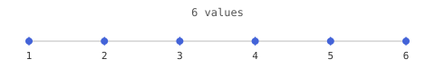

- values: `[1,2,3,4,5,6]`
- needs: `gggpx`
- byte-exact (formatting is part of the contract)

### number_ends_at_sign

A sign begins another value under the same code.

```
P10 V5-3
```


- values: `[5,-3]`
- needs: `gggpx`

### number_second_dot

A second decimal point begins another value.

```
P10 V1.2.3
```


- values: `[1.2,0.3]`
- needs: `gggpx`

### range_in_list

A range may sit inside a comma list alongside plain values.

```
P10 V1:3,9
```

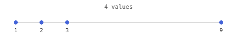

- values: `[1,2,3,9]`
- needs: `gggpx`

### unicode_list

Unicode characters list like any other values.

```
P10 V☃,你
```

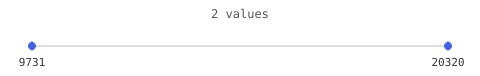

- values: `[9731,20320]`
- needs: `gggpx`

### unicode_adjacent

Adjacent Unicode characters are separate values.

```
P10 V☃你
```


- values: `[9731,20320]`
- needs: `gggpx`

### unitary_before_number

A unitary directly followed by a number is two values.

```
P10 VK5
```

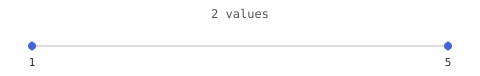

- values: `[1,5]`
- needs: `gggpx`

### unitary_after_number

A number directly followed by a unitary is two values.

```
P10 V5K
```


- values: `[5,1]`
- needs: `gggpx`

### unitary_pair

Adjacent unitaries are separate values.

```
P10 VKZ
```

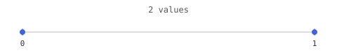

- values: `[1,0]`
- needs: `gggpx`

## map

### blit_map_axes

map's triples are (srcAxis,min,max) positional by dest axis: M0,0,3,1,1,3 = dest0<-src0 full, dest1<-src1 rows 1..3 -- i.e. it generalizes box (same as box M0,3,1,3). nearest filter (F1).

```
G40 R"bs" W"bd" T"map" M0,0,3,1,1,3 F1
G10 R"bd"
```


- values: `[4,5,6,4,5,6,7,8,9]`
- needs: `ggggx`

### blit_map_default

map with no triples leaves every dest axis identity (dest k <- src k, full source) -- an identity copy.

```
G40 R"bs" W"bd" T"map"
G10 R"bd"
```


- values: `[1,2,3,4,5,6,7,8,9]`
- needs: `ggggx`

### blit_map_transpose

Pointing each dest axis at the OTHER source axis (M1,0,3,0,0,3 = dest0<-src1, dest1<-src0) transposes the matrix (reflect across the main diagonal). nearest filter (F1).

```
G40 R"bs" W"bd" T"map" M1,0,3,0,0,3 F1
G10 R"bd"
```


- values: `[1,4,7,2,5,8,3,6,9]`
- needs: `ggggx`

### blit_map_rotate_cw

A quarter turn clockwise = swap axes + reverse the swapped-in axis: M1,2.5,-0.5,0,0,3 (dest0<-src1 reversed, dest1<-src0). nearest filter (F1).

```
G40 R"bs" W"bd" T"map" M1,2.5,-0.5,0,0,3 F1
G10 R"bd"
```


- values: `[7,4,1,8,5,2,9,6,3]`
- needs: `ggggx`

### blit_map_rotate_ccw

A quarter turn counter-clockwise = the other swap + reverse: M1,0,3,0,2.5,-0.5 (dest0<-src1, dest1<-src0 reversed). nearest filter (F1).

```
G40 R"bs" W"bd" T"map" M1,0,3,0,2.5,-0.5 F1
G10 R"bd"
```


- values: `[3,6,9,2,5,8,1,4,7]`
- needs: `ggggx`

### blit_map_by_index

Mode by index T2 == map; a single triple (0,1,3) sets dest0<-src0 over [1,3] and leaves dest1 identity (== box [1,3] on axis 0). nearest filter (F1).

```
G40 R"bs" W"bd" T2 M0,1,3 F1
G10 R"bd"
```


- values: `[2,2,3,5,5,6,8,8,9]`
- needs: `ggggx`

## matrix

### matrix_read

G10 reads a buffer back as a replayable G20 write.

```
G10 R0 P0 S3
```

- values: `[10,20,30]`
- needs: `ggggx`
- byte-exact (formatting is part of the contract)

### matrix_read_offset

G10 reads a sub-range starting at an offset (P).

```
G10 R0 P1 S2
```

- values: `[20,30]`
- needs: `ggggx`
- byte-exact (formatting is part of the contract)

### matrix_read_by_name

A register is addressable by name via R; the read replays by index.

```
G10 R"r" P0 S3
```

- values: `[10,20,30]`
- needs: `ggggx`
- byte-exact (formatting is part of the contract)

### matrix_read_by_ref

R is the universal selector: a string R resolves by name.

```
G10 R"r" P0 S3
```

- values: `[10,20,30]`
- needs: `ggggx`
- byte-exact (formatting is part of the contract)

### matrix_write_read

G20 writes values into the register; G10 reads them back.

```
G20 R0 P0 V7,8,9
G10 R0 P0 S3
```

- values: `[7,8,9]`
- needs: `ggggx`
- byte-exact (formatting is part of the contract)

### matrix_write_missing

G20 reports BufferNotFound (F5) when R does not resolve.

```
G20 R"missing" V1
```

- values: `[]`
- status: `OZ`
- needs: `ggggx`
- byte-exact (formatting is part of the contract)

### matrix_read_alias_does_not_select

L never selects a buffer; G10 requires an R reference.

```
G10 L"r"
```

- values: `[]`
- status: `OZ`
- needs: `ggggx`

### matrix_write_alias_does_not_select

L never selects a buffer; G20 requires an R reference.

```
G20 L"r" V1
```

- values: `[]`
- status: `OZ`
- needs: `ggggx`
- byte-exact (formatting is part of the contract)

### op_add

Q"add" adds the value into each cell.

```
G20 R0 P0 Q"add" V5,5,5
G10 R0 P0 S3
```

- values: `[15,25,35]`
- needs: `ggggx`

### op_sub

Q"sub" subtracts the value from each cell.

```
G20 R0 P0 Q"sub" V1,2,3
G10 R0 P0 S3
```

- values: `[9,18,27]`
- needs: `ggggx`

### op_mult

Q"mult" multiplies each cell by the value.

```
G20 R0 P0 Q"mult" V2,2,2
G10 R0 P0 S3
```

- values: `[20,40,60]`
- needs: `ggggx`

### op_min

Q"min" keeps the smaller of cell and value.

```
G20 R0 P0 Q"min" V15,15,15
G10 R0 P0 S3
```

- values: `[10,15,15]`
- needs: `ggggx`

### op_neg

Q"neg" negates the cell (a unary op; applies when V is 0).

```
G20 R0 P0 Q"neg" V0,0,0
G10 R0 P0 S3
```

- values: `[-10,-20,-30]`
- needs: `ggggx`

### op_sqrt

Q"sqrt" takes the square root of the cell (value-tolerance).

```
G20 R0 P0 Q"sqrt" V0
G10 R0 P0 S1
```

- values: `[3.1622776601683795]`
- needs: `ggggx`

### op_sin

Q"sin" computes radians with the fixed backend's integer CORDIC kernel.

```
G20 R0 P0 V0,1.5707963267948966,-1.5707963267948966
G20 R0 P0 Q"sin" V0,0,0
G10 R0 P0 S3
```

- values: `[0,1,-1]`
- needs: `ggggx`

### op_cos

Q"cos" covers the principal quadrant axes in radians.

```
G20 R0 P0 V0,1.5707963267948966,3.141592653589793
G20 R0 P0 Q"cos" V0,0,0
G10 R0 P0 S3
```

- values: `[1,0,-1]`
- needs: `ggggx`

### op_atan

Q"atan" computes the principal arctangent with integer CORDIC vectoring.

```
G20 R0 P0 V-1,0,1
G20 R0 P0 Q"atan" V0,0,0
G10 R0 P0 S3
```

- values: `[-0.7853981633974483,0,0.7853981633974483]`
- needs: `ggggx`

### op_atan2

Q"atan2" resolves all four quadrants from cell Y and incoming X.

```
G20 R0 P0 V1,1,-1
G20 R0 P0 Q"atan2" V1,-1,-1
G10 R0 P0 S3
```

- values: `[0.7853981633974483,2.356194490192345,-2.356194490192345]`
- needs: `ggggx`

## multiaxis

### multiaxis

Register-less multi-axis of lone values adds coordinate-wise.

```
P10 V1|2|3
```


- values: `[6]`
- needs: `gggpx`

### multiaxis_range

Multi-axis ranges add coordinate-wise (nested register-less sweep).

```
P10 V1:2|10:20/2|100:200/2
```

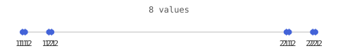

- values: `[111,112,121,122,211,212,221,222]`
- needs: `gggpx`

### multiaxis_multiplier

Multi-axis multipliers add scaled single-point coordinates.

```
P10 V1|2*10|3*100
```


- values: `[321]`
- needs: `gggpx`

### unicode_range_multi

Unicode code points combine on multiple axes.

```
P10 V☃|你
```


- values: `[30051]`
- needs: `gggpx`

## normalized

### hexnorm2_80

0H normalizes a two-nibble hex value to 0..1.

```
P10 V0H80
```


- values: `[0.5019607843137255]`
- needs: `gggpx`

### hexnorm1_8

0J normalizes a one-nibble hex value to 0..1.

```
P10 V0J8
```


- values: `[0.5333333333333333]`
- needs: `gggpx`

## offset

### blit_offset

Offset mode uses direct pixel coordinates: M1,0 means dest[x,y] = source[x+1,y]. Zero edge exposes the vacated final column.

```
G40 R"bs" W"bd" T"offset" M1,0 F1 E3
G10 R"bd"
```


- values: `[2,3,0,5,6,0,8,9,0]`
- needs: `ggggx`

### blit_offset_by_index

The transform mode index T3 selects offset. M-1,0 samples the source pixel immediately to the left, with zero beyond the edge.

```
G40 R"bs" W"bd" T3 M-1,0 F1 E3
G10 R"bd"
```


- values: `[0,1,2,0,4,5,0,7,8]`
- needs: `ggggx`

### blit_offset_fractional

Offset remains composable with filtering: M0.5,0 linearly interpolates halfway between horizontal source pixels; hold edge keeps the last column.

```
G40 R"bs" W"bd" T"offset" M0.5,0 E1
G10 R"bd"
```


- values: `[1.5,2.5,3,4.5,5.5,6,7.5,8.5,9]`
- needs: `ggggx`

### blit_offset_region

P/S clips writes in absolute destination coordinates. At destination [1,1], offset M-1,-1 samples source [0,0].

```
G40 R"bs" W"bd" T"offset" M-1,-1 P1,1 S1,1 F1 E3
G10 R"bd"
```


- values: `[0,0,0,0,1,0,0,0,0]`
- needs: `ggggx`

### off_origin

$x@[0|0] is the flat offset of the origin coordinate.

```
P10 V$m@[0|0]
```

- values: `[0]`
- needs: `gggpx`

### off_coord

$x@[a|b] is the flat offset of an exact coordinate.

```
P10 V$m@[1|2]
```

- values: `[5]`
- needs: `gggpx`

### off_coord_list

A comma list of coordinates yields each one's flat offset.

```
P10 V$m@[1|0,0|1]
```

- values: `[1,2]`
- needs: `gggpx`

### off_range

Explicit coordinate ranges sweep, yielding a block of offsets.

```
P10 V$m@[0:1|0:2]
```

- values: `[0,1,2,3,4,5]`
- needs: `gggpx`

### off_bare

A bare number in an offset ref is the offset itself.

```
P10 V$m@[4]
```

- values: `[4]`
- needs: `gggpx`

## operator

### op_add

Q"add" adds the value into each cell.

```
G20 R0 P0 Q"add" V5,5,5
G10 R0 P0 S3
```

- values: `[15,25,35]`
- needs: `ggggx`

### op_sub

Q"sub" subtracts the value from each cell.

```
G20 R0 P0 Q"sub" V1,2,3
G10 R0 P0 S3
```

- values: `[9,18,27]`
- needs: `ggggx`

### op_mult

Q"mult" multiplies each cell by the value.

```
G20 R0 P0 Q"mult" V2,2,2
G10 R0 P0 S3
```

- values: `[20,40,60]`
- needs: `ggggx`

### op_min

Q"min" keeps the smaller of cell and value.

```
G20 R0 P0 Q"min" V15,15,15
G10 R0 P0 S3
```

- values: `[10,15,15]`
- needs: `ggggx`

### op_neg

Q"neg" negates the cell (a unary op; applies when V is 0).

```
G20 R0 P0 Q"neg" V0,0,0
G10 R0 P0 S3
```

- values: `[-10,-20,-30]`
- needs: `ggggx`

### op_sqrt

Q"sqrt" takes the square root of the cell (value-tolerance).

```
G20 R0 P0 Q"sqrt" V0
G10 R0 P0 S1
```

- values: `[3.1622776601683795]`
- needs: `ggggx`

### op_sin

Q"sin" computes radians with the fixed backend's integer CORDIC kernel.

```
G20 R0 P0 V0,1.5707963267948966,-1.5707963267948966
G20 R0 P0 Q"sin" V0,0,0
G10 R0 P0 S3
```

- values: `[0,1,-1]`
- needs: `ggggx`

### op_cos

Q"cos" covers the principal quadrant axes in radians.

```
G20 R0 P0 V0,1.5707963267948966,3.141592653589793
G20 R0 P0 Q"cos" V0,0,0
G10 R0 P0 S3
```

- values: `[1,0,-1]`
- needs: `ggggx`

### op_atan

Q"atan" computes the principal arctangent with integer CORDIC vectoring.

```
G20 R0 P0 V-1,0,1
G20 R0 P0 Q"atan" V0,0,0
G10 R0 P0 S3
```

- values: `[-0.7853981633974483,0,0.7853981633974483]`
- needs: `ggggx`

### op_atan2

Q"atan2" resolves all four quadrants from cell Y and incoming X.

```
G20 R0 P0 V1,1,-1
G20 R0 P0 Q"atan2" V1,-1,-1
G10 R0 P0 S3
```

- values: `[0.7853981633974483,2.356194490192345,-2.356194490192345]`
- needs: `ggggx`

## procedures

### flow_define_only

Defining a procedure runs nothing and emits no response.

```
T10 L"p"
P10 V42
T0
```

- values: `[]`
- status: (no response)
- needs: `gggpx`, `gggtx`

### flow_define_run

T11 runs a previously defined procedure body.

```
T10 L"p"
P10 V42
T0
T11 R"p"
```

- values: `[42]`
- needs: `gggpx`, `gggtx`

### flow_unknown

Running an undefined procedure reports failure (an F<code> arg on the return).

```
T11 R"nope"
```

- values: `[]`
- status: `OZ`
- needs: `gggtx`

### flow_nested

Procedures may be defined and run nested.

```
T10 L"outer"
T10 L"inner"
P10 V7
T0
T0
T11 R"outer"
T11 R"inner"
```

- values: `[7]`
- needs: `gggpx`, `gggtx`

### proc_by_index

R addresses a procedure by index.

```
T10 L"p"
P10 V1
T0
T11 R0
```

- values: `[1]`
- needs: `gggpx`, `gggtx`

### proc_rename

T10 R<ref> L<name> renames a procedure.

```
T10 L"old"
P10 V1
T0
T10 R"old" L"new"
P10 V2
T0
T11 R"new"
```

- values: `[2]`
- needs: `gggpx`, `gggtx`

### proc_rename_old_gone

After a rename the old name no longer addresses the procedure.

```
T10 L"old"
P10 V1
T0
T10 R"old" L"new"
P10 V2
T0
T11 R"old"
```

- values: `[]`
- status: `OZ`
- needs: `gggpx`, `gggtx`

### proc_alias_does_not_select

L does not address a procedure; only R does.

```
T10 L"p"
P10 V1
T0
T11 L"p"
```

- values: `[]`
- status: `OZ`
- needs: `gggpx`, `gggtx`

## protocol

### d1_self_description

D1 describes the complete language by returning basics, command, and enum sections as GGG records.

```
D1
```

- output: structured GGG records ending in `OK`; see the [self-description protocol](protocol.md)
- needs: `gggdx`

### d2_language_basics

D2 describes stable core grammar rules and complete valid or invalid GGG source examples.

```
D2
```

- output: structured GGG records ending in `OK`; see the [self-description protocol](protocol.md)
- needs: `gggdx`

### d4_command_catalog

D4 lists command, argument, and return-relation schemas as GGG records.

```
D4
```

- output: structured GGG records ending in `OK`; see the [self-description protocol](protocol.md)
- needs: `gggdx`

### d5_enum_catalog

D5 lists enum groups and entries as GGG records.

```
D5
```

- output: structured GGG records ending in `OK`; see the [self-description protocol](protocol.md)
- needs: `gggdx`

## ranges

### range_incl

a:b expands to an inclusive integer sweep.

```
P10 V1:5
```


- values: `[1,2,3,4,5]`
- needs: `gggpx`

### range_excl

a>b expands to an exclusive sweep (stops before b).

```
P10 V1>5
```

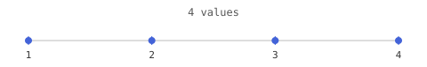

- values: `[1,2,3,4]`
- needs: `gggpx`

### range_count

a:b/n divides the inclusive range into n points.

```
P10 V0:10/5
```

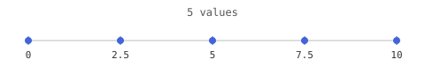

- values: `[0,2.5,5,7.5,10]`
- needs: `gggpx`

### range_step

a:b:s walks the inclusive range in steps of s.

```
P10 V0:10:2
```

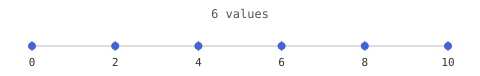

- values: `[0,2,4,6,8,10]`
- needs: `gggpx`

### range_multiplier

a:b:s:m scales each value of the stepped range by the multiplier m.

```
P10 V10:30:4:3
```

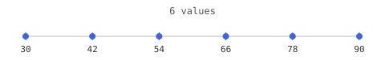

- values: `[30,42,54,66,78,90]`
- needs: `gggpx`

### lone_multiplier

a*m is the single point start*m (multiplier with no range).

```
P10 V2*10
```


- values: `[20]`
- needs: `gggpx`

### range_in_list

A range may sit inside a comma list alongside plain values.

```
P10 V1:3,9
```


- values: `[1,2,3,9]`
- needs: `gggpx`

### multiaxis

Register-less multi-axis of lone values adds coordinate-wise.

```
P10 V1|2|3
```


- values: `[6]`
- needs: `gggpx`

### multiaxis_range

Multi-axis ranges add coordinate-wise (nested register-less sweep).

```
P10 V1:2|10:20/2|100:200/2
```


- values: `[111,112,121,122,211,212,221,222]`
- needs: `gggpx`

### multiaxis_multiplier

Multi-axis multipliers add scaled single-point coordinates.

```
P10 V1|2*10|3*100
```


- values: `[321]`
- needs: `gggpx`

### range_open_no_register

Without a register an open range has no dimension and is one point.

```
P10 V1:
```


- values: `[1]`
- needs: `gggpx`

### unicode_range

A Unicode character can be the start of a range.

```
P10 V☃:9735
```

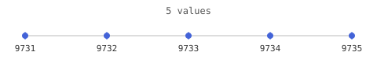

- values: `[9731,9732,9733,9734,9735]`
- needs: `gggpx`

### unitary_range

A unitary constant acts as a range bound like any number.

```
P10 VK:5
```

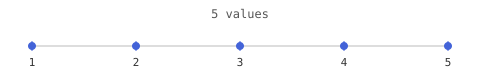

- values: `[1,2,3,4,5]`
- needs: `gggpx`

### unitary_range_excl

Z as an exclusive range bound sweeps 0 up to (not including) 10.

```
P10 VZ>10
```

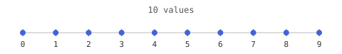

- values: `[0,1,2,3,4,5,6,7,8,9]`
- needs: `gggpx`

### unitary_exponent_unaffected

Scientific notation is unaffected by unitary completion.

```
P10 V5e4
```


- values: `[50000]`
- needs: `gggpx`

## reference

### matrix_read_alias_does_not_select

L never selects a buffer; G10 requires an R reference.

```
G10 L"r"
```

- values: `[]`
- status: `OZ`
- needs: `ggggx`

### matrix_write_alias_does_not_select

L never selects a buffer; G20 requires an R reference.

```
G20 L"r" V1
```

- values: `[]`
- status: `OZ`
- needs: `ggggx`
- byte-exact (formatting is part of the contract)

## references

### ref_bare

A bare $name reads the whole register in order.

```
P10 V$r
```

- values: `[10,20,30]`
- needs: `gggpx`

### ref_two

A reference can appear mid-line, then another follows.

```
P10 V$r V$r
```

- values: `[10,20,30,10,20,30]`
- needs: `gggpx`
- byte-exact (formatting is part of the contract)

### ref_unknown

An unknown register reference yields no values.

```
P10 V$x
```

- values: `[]`
- needs: `gggpx`

### ref_subscript

$name[i] reads a single indexed scalar.

```
P10 V$r[1]
```

- values: `[20]`
- needs: `gggpx`

### ref_sub_range

$name[a:b] reads an inclusive range of indices.

```
P10 V$r[0:2]
```

- values: `[10,20,30]`
- needs: `gggpx`

### ref_sub_list

$name[a,b] reads a comma list of indices.

```
P10 V$r[0,2]
```

- values: `[10,30]`
- needs: `gggpx`

### ref_sub_open

$name[a:] runs from a to the end of the register.

```
P10 V$r[1:]
```

- values: `[20,30]`
- needs: `gggpx`

### ref_sub_open_excl

$name[a>] also runs to the end, excluding the dimension itself.

```
P10 V$r[1>]
```

- values: `[20,30]`
- needs: `gggpx`

### ref_sub_open_full

$name[0:] reads the whole register.

```
P10 V$r[0:]
```

- values: `[10,20,30]`
- needs: `gggpx`

### ref_sub_bare_open

$name[:] is an open range with no start: the whole register.

```
P10 V$r[:]
```

- values: `[10,20,30]`
- needs: `gggpx`

### ref_sub_multi

$name[a:b|c:d] expands axes coordinate-wise into flat indices.

```
P10 V$r[0:1|0:1]
```

- values: `[10,20,20,30]`
- needs: `gggpx`

### ref_sub_multi_lone

Lone-value multi-axis subscript indexes an exact coordinate.

```
P10 V$r[1|1]
```

- values: `[30]`
- needs: `gggpx`

### off_origin

$x@[0|0] is the flat offset of the origin coordinate.

```
P10 V$m@[0|0]
```

- values: `[0]`
- needs: `gggpx`

### off_coord

$x@[a|b] is the flat offset of an exact coordinate.

```
P10 V$m@[1|2]
```

- values: `[5]`
- needs: `gggpx`

### off_coord_list

A comma list of coordinates yields each one's flat offset.

```
P10 V$m@[1|0,0|1]
```

- values: `[1,2]`
- needs: `gggpx`

### off_range

Explicit coordinate ranges sweep, yielding a block of offsets.

```
P10 V$m@[0:1|0:2]
```

- values: `[0,1,2,3,4,5]`
- needs: `gggpx`

### off_bare

A bare number in an offset ref is the offset itself.

```
P10 V$m@[4]
```

- values: `[4]`
- needs: `gggpx`

## region

### blit_offset_region

P/S clips writes in absolute destination coordinates. At destination [1,1], offset M-1,-1 samples source [0,0].

```
G40 R"bs" W"bd" T"offset" M-1,-1 P1,1 S1,1 F1 E3
G10 R"bd"
```


- values: `[0,0,0,0,1,0,0,0,0]`
- needs: `ggggx`

## registers

### iter_offset

T9 P writes each iteration value at a scalar offset in the selected register.

```
T9 V7,8 R"r" P1
P10 V$r[0:2]
T0
```

- values: `[10,7,30,10,8,30]`
- needs: `gggpx`, `gggtx`

## rotate

### blit_map_transpose

Pointing each dest axis at the OTHER source axis (M1,0,3,0,0,3 = dest0<-src1, dest1<-src0) transposes the matrix (reflect across the main diagonal). nearest filter (F1).

```
G40 R"bs" W"bd" T"map" M1,0,3,0,0,3 F1
G10 R"bd"
```


- values: `[1,4,7,2,5,8,3,6,9]`
- needs: `ggggx`

### blit_map_rotate_cw

A quarter turn clockwise = swap axes + reverse the swapped-in axis: M1,2.5,-0.5,0,0,3 (dest0<-src1 reversed, dest1<-src0). nearest filter (F1).

```
G40 R"bs" W"bd" T"map" M1,2.5,-0.5,0,0,3 F1
G10 R"bd"
```


- values: `[7,4,1,8,5,2,9,6,3]`
- needs: `ggggx`

### blit_map_rotate_ccw

A quarter turn counter-clockwise = the other swap + reverse: M1,0,3,0,2.5,-0.5 (dest0<-src1, dest1<-src0 reversed). nearest filter (F1).

```
G40 R"bs" W"bd" T"map" M1,0,3,0,2.5,-0.5 F1
G10 R"bd"
```


- values: `[3,6,9,2,5,8,1,4,7]`
- needs: `ggggx`

## self-description

### d1_self_description

D1 describes the complete language by returning basics, command, and enum sections as GGG records.

```
D1
```

- output: structured GGG records ending in `OK`; see the [self-description protocol](protocol.md)
- needs: `gggdx`

### d2_language_basics

D2 describes stable core grammar rules and complete valid or invalid GGG source examples.

```
D2
```

- output: structured GGG records ending in `OK`; see the [self-description protocol](protocol.md)
- needs: `gggdx`

### d4_command_catalog

D4 lists command, argument, and return-relation schemas as GGG records.

```
D4
```

- output: structured GGG records ending in `OK`; see the [self-description protocol](protocol.md)
- needs: `gggdx`

### d5_enum_catalog

D5 lists enum groups and entries as GGG records.

```
D5
```

- output: structured GGG records ending in `OK`; see the [self-description protocol](protocol.md)
- needs: `gggdx`

## signs

### print_negatives

Negative decimals are preserved.

```
P10 V-5,-10,15
```

- values: `[-5,-10,15]`
- needs: `gggpx`

## subscript

### ref_subscript

$name[i] reads a single indexed scalar.

```
P10 V$r[1]
```

- values: `[20]`
- needs: `gggpx`

### ref_sub_range

$name[a:b] reads an inclusive range of indices.

```
P10 V$r[0:2]
```

- values: `[10,20,30]`
- needs: `gggpx`

### ref_sub_list

$name[a,b] reads a comma list of indices.

```
P10 V$r[0,2]
```

- values: `[10,30]`
- needs: `gggpx`

### ref_sub_open

$name[a:] runs from a to the end of the register.

```
P10 V$r[1:]
```

- values: `[20,30]`
- needs: `gggpx`

### ref_sub_open_excl

$name[a>] also runs to the end, excluding the dimension itself.

```
P10 V$r[1>]
```

- values: `[20,30]`
- needs: `gggpx`

### ref_sub_open_full

$name[0:] reads the whole register.

```
P10 V$r[0:]
```

- values: `[10,20,30]`
- needs: `gggpx`

### ref_sub_bare_open

$name[:] is an open range with no start: the whole register.

```
P10 V$r[:]
```

- values: `[10,20,30]`
- needs: `gggpx`

### ref_sub_multi

$name[a:b|c:d] expands axes coordinate-wise into flat indices.

```
P10 V$r[0:1|0:1]
```

- values: `[10,20,20,30]`
- needs: `gggpx`

### ref_sub_multi_lone

Lone-value multi-axis subscript indexes an exact coordinate.

```
P10 V$r[1|1]
```

- values: `[30]`
- needs: `gggpx`

## trig

### op_sin

Q"sin" computes radians with the fixed backend's integer CORDIC kernel.

```
G20 R0 P0 V0,1.5707963267948966,-1.5707963267948966
G20 R0 P0 Q"sin" V0,0,0
G10 R0 P0 S3
```

- values: `[0,1,-1]`
- needs: `ggggx`

### op_cos

Q"cos" covers the principal quadrant axes in radians.

```
G20 R0 P0 V0,1.5707963267948966,3.141592653589793
G20 R0 P0 Q"cos" V0,0,0
G10 R0 P0 S3
```

- values: `[1,0,-1]`
- needs: `ggggx`

### op_atan

Q"atan" computes the principal arctangent with integer CORDIC vectoring.

```
G20 R0 P0 V-1,0,1
G20 R0 P0 Q"atan" V0,0,0
G10 R0 P0 S3
```

- values: `[-0.7853981633974483,0,0.7853981633974483]`
- needs: `ggggx`

### op_atan2

Q"atan2" resolves all four quadrants from cell Y and incoming X.

```
G20 R0 P0 V1,1,-1
G20 R0 P0 Q"atan2" V1,-1,-1
G10 R0 P0 S3
```

- values: `[0.7853981633974483,2.356194490192345,-2.356194490192345]`
- needs: `ggggx`

## unicode

### unicode_snowman

A Unicode character decodes to its code point.

```
P10 V☃
```

- values: `[9731]`
- needs: `gggpx`

### unicode_cjk

A CJK character decodes to its code point.

```
P10 V你
```

- values: `[20320]`
- needs: `gggpx`

### unicode_greek

A Greek letter decodes to its code point.

```
P10 Vα
```

- values: `[945]`
- needs: `gggpx`

### unicode_euro

The euro sign decodes to its code point.

```
P10 V€
```

- values: `[8364]`
- needs: `gggpx`

### unicode_emoji

An astral-plane emoji decodes to its full code point.

```
P10 V😀
```

- values: `[128512]`
- needs: `gggpx`

### unicode_list

Unicode characters list like any other values.

```
P10 V☃,你
```


- values: `[9731,20320]`
- needs: `gggpx`

### unicode_range

A Unicode character can be the start of a range.

```
P10 V☃:9735
```


- values: `[9731,9732,9733,9734,9735]`
- needs: `gggpx`

### unicode_range_multi

Unicode code points combine on multiple axes.

```
P10 V☃|你
```


- values: `[30051]`
- needs: `gggpx`

### unicode_adjacent

Adjacent Unicode characters are separate values.

```
P10 V☃你
```


- values: `[9731,20320]`
- needs: `gggpx`

### unicode_negated

A sign before a Unicode character negates its code point.

```
P10 V-☃
```

- values: `[-9731]`
- needs: `gggpx`

## unitary

### unitary_one

K is the unitary constant one.

```
P10 VK
```

- values: `[1]`
- needs: `gggpx`

### unitary_zero

Z is the unitary constant zero.

```
P10 VZ
```

- values: `[0]`
- needs: `gggpx`

### unitary_minusone

N is the unitary constant minus one.

```
P10 VN
```

- values: `[-1]`
- needs: `gggpx`

### unitary_range

A unitary constant acts as a range bound like any number.

```
P10 VK:5
```


- values: `[1,2,3,4,5]`
- needs: `gggpx`

### unitary_range_excl

Z as an exclusive range bound sweeps 0 up to (not including) 10.

```
P10 VZ>10
```


- values: `[0,1,2,3,4,5,6,7,8,9]`
- needs: `gggpx`

### unitary_pi

π decodes to the mathematical constant.

```
P10 Vπ
```

- values: `[3.141592653589793]`
- needs: `gggpx`

### unitary_tau

τ decodes to 2π.

```
P10 Vτ
```

- values: `[6.283185307179586]`
- needs: `gggpx`

### unitary_before_number

A unitary directly followed by a number is two values.

```
P10 VK5
```


- values: `[1,5]`
- needs: `gggpx`

### unitary_after_number

A number directly followed by a unitary is two values.

```
P10 V5K
```


- values: `[5,1]`
- needs: `gggpx`

### unitary_pair

Adjacent unitaries are separate values.

```
P10 VKZ
```


- values: `[1,0]`
- needs: `gggpx`

### unitary_exponent_unaffected

Scientific notation is unaffected by unitary completion.

```
P10 V5e4
```


- values: `[50000]`
- needs: `gggpx`

### unitary_negated

A sign before a constant negates it.

```
P10 V-K
```

- values: `[-1]`
- needs: `gggpx`

### unitary_negated_symbol

A sign negates a symbolic constant.

```
P10 V-π
```

- values: `[-3.141592653589793]`
- needs: `gggpx`

### unitary_negated_twice

Negating a negative constant yields a positive value.

```
P10 V-N
```

- values: `[1]`
- needs: `gggpx`

